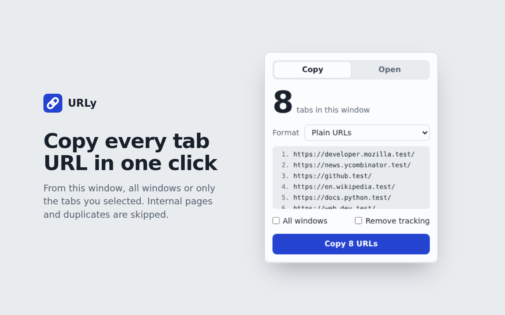

<p align="center">
  
</p>

<h1 align="center">URLy</h1>

<p align="center">
  Copy the URLs of your open tabs and open every link in pasted text, in one click.
</p>

<p align="center">
  <a href="https://github.com/AkosKappel/URLy/actions/workflows/ci.yml"></a>
  <a href="https://github.com/AkosKappel/URLy/releases/latest"></a>
  <a href="LICENSE"></a>
</p>

<p align="center">
  
</p>

## Features

- **Copy**: copy the URLs of the tabs in the current window, all windows, or only the tabs you have selected. Internal pages (`chrome://`, `about:` and so on) and duplicates are skipped.
- **Formats**: plain URLs, Markdown links, title and URL, HTML links (also copied as rich text), CSV, JSON, or a custom template using `{title}`, `{url}`, `{host}`, `{domain}`, `{path}`, `{index}`, `\t` and `\n`.
- **Preview**: the popup shows the copied text before you copy.
- **Remove tracking**: optionally strip `utm_*`, `fbclid`, `gclid` and similar parameters.
- **Open**: paste any text and URLy finds the links in it and opens them as background tabs, or in a new window. It asks before opening more than 20.
- **Open from clipboard**: press `Alt+Shift+O`, or right-click the toolbar icon, to open the links on the clipboard next to the current tab. The first use asks for clipboard access. More than 20 links shows `20+` on the icon and opens nothing; paste them into the popup instead.
- **Context menus**: right-click the toolbar icon to copy tab URLs (with your saved format or any other) or open the links on the clipboard, or right-click selected text to open the links in it.

| Shortcut      | Action                                            |
| ------------- | ------------------------------------------------- |
| `Alt+Shift+U` | Open the popup                                    |
| `Alt+Shift+C` | Copy tab URLs with your saved format, no popup    |
| `Alt+Shift+O` | Open the links on the clipboard, no popup         |
| `Ctrl+V`      | In the popup: switch to Open with the pasted text |
| `Ctrl+Enter`  | In the Open text box: open the links              |

Shortcuts can be changed at `chrome://extensions/shortcuts` (Chrome, Edge) or Manage Extension Shortcuts in `about:addons` (Firefox).

Supports Chrome, Edge and Firefox (Manifest V3).

## Install

Download the zip for your browser from the [latest release](https://github.com/AkosKappel/URLy/releases/latest).

- **Chrome, Edge**: unzip it, open `chrome://extensions` (or `edge://extensions`), turn on Developer mode, click **Load unpacked** and select the unzipped folder.
- **Firefox**: open `about:debugging#/runtime/this-firefox`, click **Load Temporary Add-on** and select the zip. Temporary add-ons are removed when Firefox restarts.

To build from source instead, see [Development](#development).

## Development

Requires Node 24 and pnpm.

```bash
pnpm install
pnpm dev            # Chrome with live reload
pnpm dev:firefox    # Firefox with live reload
```

| Command                                           | Purpose                                             |
| ------------------------------------------------- | --------------------------------------------------- |
| `pnpm check`                                      | Typecheck, lint, format check and unit tests        |
| `pnpm test:e2e`                                   | Build, then run Playwright against the extension    |
| `pnpm zip` / `pnpm zip:edge` / `pnpm zip:firefox` | Build store-ready zips into `.output/`              |
| `pnpm assets:icons`                               | Re-export PNG icons from `public/icon/icon.svg`     |
| `pnpm assets:store`                               | Regenerate store screenshots and images in `store/` |

Run `pnpm exec playwright install chromium` once before the first e2e run.

## Releasing

1. Bump `version` in `package.json` and commit.
2. Tag and push: `git tag v0.2.0 && git push origin v0.2.0`.

The Release workflow checks that the tag matches the version, runs all checks and attaches the Chrome, Edge and Firefox zips (plus the Firefox sources zip for AMO review) to a GitHub release. Store listing texts, permission justifications and images are in [store/](store/listing.md).

## Contributing

Bug reports and pull requests are welcome. Open an [issue](https://github.com/AkosKappel/URLy/issues) first for larger changes. Run `pnpm check` and `pnpm test:e2e` before opening a pull request.

## Privacy

URLy collects no data and makes no network requests. See [PRIVACY.md](PRIVACY.md).

## License

[MIT](LICENSE)
